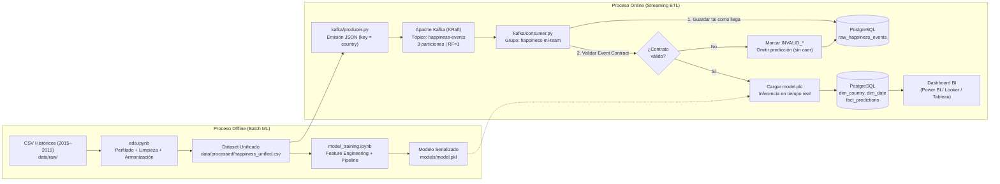
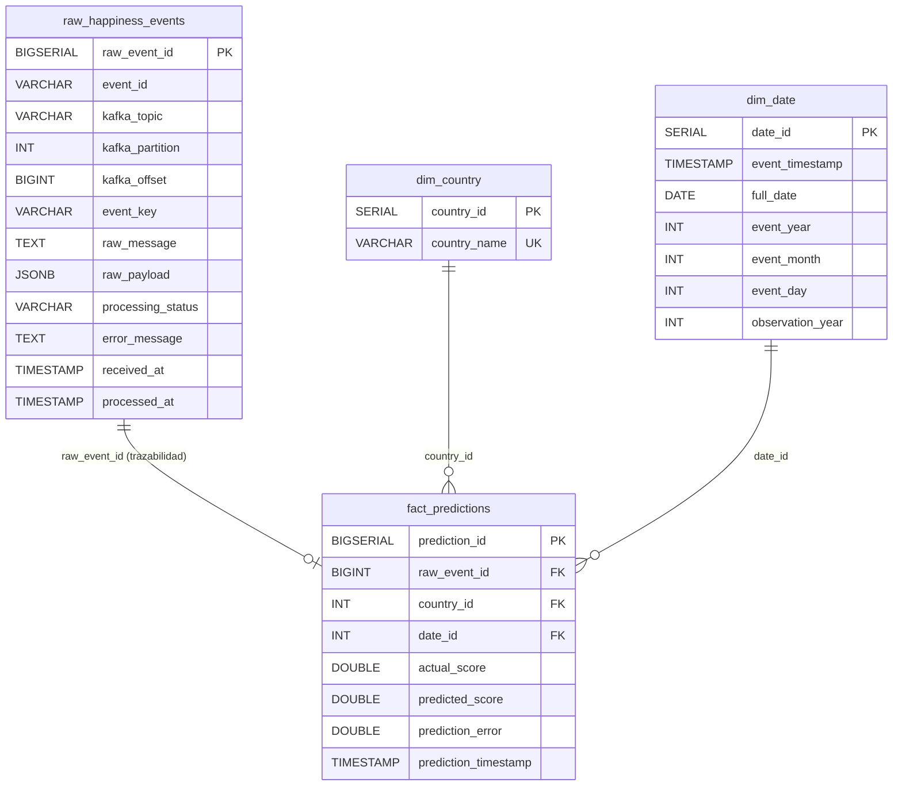

# Workshop 3: Streaming ETL con Apache Kafka y Machine Learning

> **Curso:** ETL (G01) — Programa de Ingeniería de Datos e Inteligencia Artificial  
> **Institución:** Universidad Autónoma de Occidente (UAO)  
> **Enfoque del proyecto:** Construir una arquitectura de streaming ETL limpia, reproducible y tolerante a fallos para inferencia en tiempo real, priorizando la integración del pipeline, la trazabilidad de eventos y la calidad de los datos sobre la optimización compleja de hiperparámetros.

---

## 1. Descripción del Proyecto

En este taller realizo la transición de un pipeline ETL tradicional por lotes (*batch*) hacia una arquitectura orientada a eventos (*event-driven streaming*) utilizando **Apache Kafka**, **Scikit-learn** y **PostgreSQL**.

A partir de los registros históricos del *World Happiness Report* (`2015.csv` – `2019.csv`), el proyecto se divide en dos flujos complementarios:

1. **Proceso Offline (ML Batch):** Perfilado exploratorio, limpieza, armonización de esquemas heterogéneos entre años, ingeniería de características y entrenamiento de un `Pipeline` de regresión serializado como `models/model.pkl`.
2. **Proceso Online (Streaming ETL):** Simulación de llegada de eventos en tiempo real con un productor de Kafka, consumo estructurado con validación de contrato de datos (*Event Contract*), almacenamiento inmediato del evento crudo para auditoría, inferencia en tiempo real con el modelo entrenado y persistencia de resultados en un modelo analítico en PostgreSQL listo para visualización BI.

---

## 2. Arquitectura del Sistema



### Estructura del Repositorio

```text
workshop_3/
├── data/
│   ├── raw/                  # CSV originales de 2015 a 2019
│   ├── processed/            # happiness_unified.csv generado tras la armonización
│   └── streaming/            # Recursos auxiliares para pruebas de streaming
├── notebooks/
│   ├── eda.ipynb             # EDA, diagnóstico de calidad y armonización batch
│   └── model_training.ipynb  # Selección de features, entrenamiento y serialización
├── kafka/
│   ├── producer.py           # Productor Kafka (simulación record-by-record)
│   └── consumer.py           # Consumidor Kafka (auditoría + validación + inferencia)
├── models/
│   └── model.pkl             # Pipeline scikit-learn (SimpleImputer + StandardScaler + LinearRegression)
├── sql/
│   ├── create_tables.sql     # DDL de tabla cruda, dimensiones y tabla de hechos
│   └── kpis.sql              # Consultas analíticas para el dashboard
├── dashboards/               # Archivos del tablero y capturas de pantalla
├── docker-compose.yml        # Kafka single-broker (KRaft), kafka-init y PostgreSQL 16
├── requirements.txt          # Dependencias Python (compatibles con Python 3.13)
├── .env.example              # Plantilla de configuración de entorno
└── README.md                 # Documentación del proyecto
```

---

## 3. Decisiones de Limpieza de Datos (Fase A — `eda.ipynb`)

Al analizar los cinco archivos históricos (`2015.csv` con 158 filas y 12 columnas; `2016.csv` con 157×13; `2017.csv` con 155×12; `2018.csv` con 156×9; `2019.csv` con 156×9 — **782 registros en total**), identifiqué **30 nombres de columna distintos** y varias inconsistencias que resolví así:

1. **Armonización de nombres de columnas (`SCHEMA_MAPPING`):**
   * Unifiqué variantes entre años hacia un esquema canónico alineado con el contrato de Kafka:
     * `Country` / `Country or region` → `country`
     * `Happiness Score` / `Happiness.Score` / `Score` → `happiness_score`
     * `Economy (GDP per Capita)` / `Economy..GDP.per.Capita.` / `GDP per capita` → `gdp`
     * `Family` / `Social support` → `family`
     * `Health (Life Expectancy)` / `Health..Life.Expectancy.` / `Healthy life expectancy` → `health`
     * `Freedom` / `Freedom to make life choices` → `freedom`
     * `Generosity` → `generosity`
     * `Trust (Government Corruption)` / `Trust..Government.Corruption.` / `Perceptions of corruption` → `corruption`
   * Inyecté explícitamente la columna `year` (`int64`) a partir de cada archivo fuente.

2. **Exclusión justificada de columnas incompatibles o con fuga de datos (*Target Leakage*):**
   * **`Happiness Rank` / `Happiness.Rank` / `Overall rank`:** Excluida porque es un derivado directo del ordenamiento de `happiness_score`; usarla causaría *target leakage* severo.
   * **`Standard Error`, `Lower/Upper Confidence Interval`, `Whisker.high/low`:** Excluidas porque representan márgenes de incertidumbre alrededor de `happiness_score` (fuga del objetivo) y solo existen entre 2015 y 2017.
   * **`Dystopia Residual` / `Dystopia.Residual`:** Excluida porque desaparece en 2018–2019 y forma parte de la suma exacta que reconstruye el puntaje objetivo.
   * **`Region`:** Excluida porque únicamente viene informada en 2015 y 2016 (~40% del dataset) y no hace parte del *Event Contract* de Kafka.

3. **Normalización de nombres de países (`COUNTRY_CANONICAL_MAP`):**
   * Detecté 6 pares de entidades equivalentes con distinta grafía entre años:
     * `Hong Kong S.A.R., China` → `Hong Kong`
     * `Taiwan Province of China` → `Taiwan`
     * `Trinidad & Tobago` → `Trinidad and Tobago`
     * `Northern Cyprus` → `North Cyprus`
     * `Macedonia` → `North Macedonia`
     * `Somaliland region` → `Somaliland Region`
   * Al unificarlas se pasa de **170 cadenas crudas a 164 países únicos**, evitando duplicación de entidades en `dim_country` y manteniendo particionamiento consistente en Kafka cuando `country` actúa como *event key*.

4. **Manejo de valores faltantes y duplicados:**
   * Verifiqué **0 filas duplicadas** exactas y **0 duplicados** en la llave `(country, year)`.
   * Encontré únicamente **1 valor nulo** en todo el histórico: `United Arab Emirates` (2018) en `Perceptions of corruption`. En lugar de eliminar el registro (perdiendo indicadores válidos) o imputar con la mediana global (`~0.091`, que subestimaría el perfil institucional de EAU), lo imputé usando la **mediana histórica del propio país** en los demás años (`~0.3400`). Además, dejar el dataset sin nulos evita emitir valores `NaN`/`null` inválidos al serializar JSON hacia Kafka.

5. **Conservación de ceros y *outliers* legítimos:**
   * En la metodología del *World Happiness Report*, cada año el país con menor desempeño en un indicador recibe `0.000` (ancla *Dystopia*, por ejemplo Grecia en `generosity` o Somalia en `gdp`). No son datos corruptos.
   * Los valores atípicos por criterio IQR (especialmente valores altos en `corruption` > `0.309` en países nórdicos o Singapur) corresponden a países con muy alta confianza institucional real. Se conservan para no distorsionar la variabilidad global.

---

## 4. Decisiones de Ingeniería de Características y Modelo (Fase A — `model_training.ipynb`)

* **Variables seleccionadas (`FEATURE_COLUMNS`):** `["gdp", "family", "health", "freedom", "generosity", "corruption"]`.
  * Tienen disponibilidad completa en los 5 años, correlación positiva con `happiness_score` (destacando `gdp`, `health`, `family` y `freedom`) y paridad exacta 1 a 1 con el *Event Contract* de Kafka.
* **Exclusión de `country` como feature:** Codificar 164 categorías sobre 782 filas introduciría sobreajuste (el modelo memorizaría países en vez de aprender la relación socioeconómica) y fallaría si llega un país nuevo en streaming. Por eso `country` se usa solo como llave de Kafka y en `dim_country`.
* **Exclusión de `year` como feature:** Su correlación lineal con `happiness_score` es prácticamente nula (`r ≈ 0.007`) e incluirla generaría extrapolaciones artificiales cuando lleguen eventos simulados con años futuros.
* **Prevención de *Target Leakage*:** `happiness_score` (`actual_happiness_score` en streaming) se usa únicamente como variable objetivo `y` durante el entrenamiento y para calcular `prediction_error` en la evaluación posterior; jamás entra a `X`.
* **Pipeline reproducible:** Encapsulé `SimpleImputer(strategy="median")` + `StandardScaler()` + `LinearRegression()` en un único `sklearn.pipeline.Pipeline` entrenado con división **70% entrenamiento / 30% prueba** (`random_state=42`). Escalar dentro del `Pipeline` evita fuga entre *train* y *test*, conserva `feature_names_in_` dentro de `models/model.pkl` y garantiza exactamente el mismo preprocesamiento durante la inferencia en Kafka. Se eligió `LinearRegression` por su simplicidad, interpretabilidad y latencia mínima en streaming, tras compararlo de referencia con `DecisionTreeRegressor` y `RandomForestRegressor` usando `MAE`, `RMSE` y `R²`.

---

## 5. Pipeline de Apache Kafka y Contrato de Eventos (Fase B)

### Infraestructura Local (`docker-compose.yml`)

* **Broker:** Contenedor único con imagen oficial `apache/kafka:3.9.0` en modo **KRaft** (combinando rol de `broker` y `controller`, eliminando la dependencia de ZooKeeper).
* **Listeners:** Listener interno `PLAINTEXT://kafka:29092` para contenedores en la red Docker y listener externo `PLAINTEXT_HOST://localhost:9092` para los scripts Python locales.
* **Tópico:** `happiness-events`, creado explícitamente por el servicio `kafka-init` con **3 particiones** y **factor de replicación 1** (se desactivó `KAFKA_AUTO_CREATE_TOPICS_ENABLE` para evitar tópicos mal configurados por error).

### Flujo Productor → Consumidor

* **Productor (`kafka/producer.py`):** Lee `data/processed/happiness_unified.csv` registro por registro, construye el payload JSON con `event_id` único y `event_time` ISO-8601 actual, envía los eventos usando `country` como **llave del mensaje** (garantizando que los eventos de un mismo país caigan en la misma partición) y aplica un retardo configurable (`PRODUCER_DELAY_SECONDS`) para simular llegada continua.
* **Consumidor (`kafka/consumer.py`):** Se suscribe al tópico usando el grupo **`happiness-ml-team`**. Para cada mensaje sigue estrictamente el flujo:
  1. **Persistencia cruda inmediata:** Inserta el mensaje original en `raw_happiness_events` antes de cualquier transformación o predicción.
  2. **Validación del Event Contract:** Verifica campos obligatorios, tipos, valores numéricos válidos y presencia de las 6 features del modelo.
  3. **Inferencia en tiempo real:** Si el evento es válido, extrae las features en el orden exacto de entrenamiento (`FEATURE_COLUMNS`), carga `models/model.pkl`, calcula `predicted_score` y `prediction_error` y guarda el resultado en el modelo dimensional (`dim_country`, `dim_date`, `fact_predictions`).
  4. **Resiliencia:** Si un evento es inválido o falla la predicción, **no detiene el pipeline**; actualiza el estado en `raw_happiness_events` y omite la inserción en `fact_predictions`.

### Contrato de Eventos (*Event Contract*)

Ejemplo de payload JSON emitido al tópico `happiness-events`:

```json
{
  "event_id": "E001",
  "country": "Colombia",
  "year": 2019,
  "gdp": 1.2,
  "family": 0.8,
  "health": 0.9,
  "freedom": 0.6,
  "generosity": 0.3,
  "corruption": 0.1,
  "actual_happiness_score": 6.2,
  "event_time": "2026-10-30T15:30:00"
}
```

| Campo | Tipo esperado | Regla de validación | Uso en el consumidor |
| :--- | :--- | :--- | :--- |
| `event_id` | `string` | Cadena no vacía y única | Trazabilidad del evento |
| `country` | `string` | Cadena no vacía (también *Kafka key*) | Dimensión `dim_country` |
| `year` | `int` | Entero válido de observación histórica | Dimensión `dim_date` |
| `gdp`, `family`, `health`, `freedom`, `generosity`, `corruption` | `float` / numérico | Obligatorios, finitos (sin `NaN`/`Inf`), no negativos | Features de entrada para `model.pkl` |
| `actual_happiness_score` | `float` / numérico | Numérico finito (no entra al modelo) | Evaluación (`prediction_error`) |
| `event_time` | `string` (ISO-8601) | Timestamp ISO-8601 válido | Dimensión `dim_date` y auditoría |

**Estados de procesamiento registrados en `raw_happiness_events`:**
* `VALID`: Cumple el contrato y generó predicción exitosamente.
* `INVALID_SCHEMA`: JSON malformado, campos obligatorios faltantes o tipos de datos incompatibles.
* `INVALID_VALUES`: Valores numéricos nulos/NaN/infinitos/fuera de rango o timestamp `event_time` inválido.
* `PREDICTION_ERROR`: Error inesperado al ejecutar inferencia con `model.pkl` o al persistir la predicción.

---

## 6. Esquema de Base de Datos (Fase C — PostgreSQL)

La base de datos (`happiness_db` en PostgreSQL 16) separa la **capa cruda de trazabilidad** del **modelo dimensional analítico** (esquema estrella):



* **`raw_happiness_events` (Staging / Auditoría):** Almacena el evento exacto recibido desde Kafka en formato `JSONB` junto con metadatos de Kafka (`partition`, `offset`, `event_key`) y su `processing_status`. Permite auditar, depurar eventos rechazados o reprocesar en el futuro si cambian las reglas del modelo. No es una dimensión.
* **`dim_country` y `dim_date` (Dimensiones):** Desnormalizan los atributos de país y tiempo para facilitar agregaciones y filtros en herramientas de BI.
* **`fact_predictions` (Tabla de Hechos):** Almacena `actual_score`, `predicted_score`, `prediction_error` y `prediction_timestamp`, vinculando cada predicción a su evento original en `raw_happiness_events` mediante la llave foránea **`raw_event_id`**.

---

## 7. Dashboard y KPIs

El tablero analítico (Power BI / Looker Studio / Tableau) se conecta **directamente a PostgreSQL** consultando las tablas dimensionales y de hechos (apoyado en `sql/kpis.sql`), sin leer archivos CSV. Los 4 KPIs mínimos del proyecto son:

1. **Error promedio de predicción (*Average Prediction Error*):** Promedio global de `prediction_error` (MAE) para monitorear la precisión operativa del modelo en streaming.
2. **Predicciones por país (*Predictions by Country*):** Conteo de eventos procesados y error promedio desagregado por `dim_country`.
3. **Puntaje predicho vs puntaje real (*Predicted vs Actual Score*):** Comparativa directa entre `predicted_score` y `actual_score` por país/observación para identificar subestimaciones o sobreestimaciones.
4. **Tendencias de predicción en el tiempo (*Prediction Trends Over Time*):** Evolución temporal del volumen de predicciones y del error promedio usando `dim_date` / `prediction_timestamp`.

*(Las capturas y archivo del dashboard se almacenarán en la carpeta `dashboards/` tras completar la ejecución end-to-end).*

---

## 8. Instrucciones de Ejecución

### Prerrequisitos
* Docker y Docker Compose instalados y activos.
* Python 3.10+ (probado con Python 3.13).

### Paso 1: Configurar variables de entorno e instalar dependencias
```powershell
Copy-Item .env.example .env
pip install -r requirements.txt
```

### Paso 2: Levantar Apache Kafka y PostgreSQL con Docker
```powershell
docker compose up -d

# Verificar que el tópico 'happiness-events' fue creado con 3 particiones y RF=1
docker compose logs kafka-init
```

### Paso 3: Ejecutar Fase A (EDA y Entrenamiento Batch)
Ejecuta en orden los notebooks en Jupyter o VS Code:
1. `notebooks/eda.ipynb` → genera `data/processed/happiness_unified.csv`.
2. `notebooks/model_training.ipynb` → entrena el pipeline y genera `models/model.pkl`.

### Paso 4: Inicializar las tablas en PostgreSQL (Fase C)
Ejecuta el script DDL `sql/create_tables.sql` contra el contenedor de PostgreSQL:
```powershell
Get-Content sql/create_tables.sql | docker exec -i workshop3-postgres psql -U etl_user -d happiness_db
```

### Paso 5: Ejecutar el pipeline de Streaming (Fase B)
En dos terminales independientes:

```powershell
# Terminal 1: Iniciar el consumidor (grupo happiness-ml-team)
python kafka/consumer.py
```
```powershell
# Terminal 2: Iniciar el productor (emite eventos desde data/processed/happiness_unified.csv)
python kafka/producer.py
```

### Paso 6: Consultar KPIs
Ejecuta las consultas de `sql/kpis.sql` en PostgreSQL o conecta tu herramienta BI a `localhost:5433` (base de datos `happiness_db`, usuario `etl_user`).
